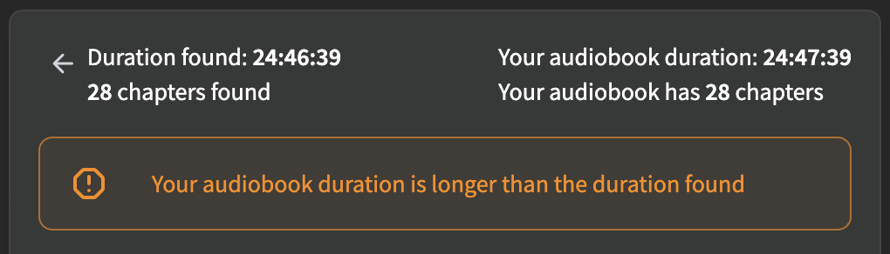

# Realign Chapters

The realignment workflow keeps the **titles** of an existing Chapter Reference and attempts to automatically fix misaligned **timestamps** by detecting cues in the audio.

## When to use it

Realignment is for situations where you have a [Chapter Reference](../getting-started/chapter-references.md) whose titles are correct, but whose timestamps are slightly off. For example, when using the chapter (Audnexus) lookup feature in Audiobookshelf, you'll often see this familiar message when the durations differ:

{ width="480"; .center }

A duration mismatch between your audiobook and the Audnexus data almost always means that the Audnexus chapters will not correctly align with your book's audio. The realignment workflow fixes this by performing targeted smart detection around the areas where it thinks the chapters should go, and then shifts the timestamps to the best-fitting locations.

!!! info "Realignment Accuracy"
    Chapter realignment works best when the book and Reference durations differ by *only a few minutes*. The greater the difference, the less accurate realignment becomes. If the durations are off by 10+ minutes, consider the possibility that your selected Reference corresponds to a different version of your book.

## Steps

1. [**Select a book**](../getting-started/finding-a-book.md) from Achew's main screen.
2. Choose **Realign Chapters** on the *Select a Workflow* screen.
3. **Pick a Reference**, e.g. Audnexus. If there are no References, or you wish use another Reference, click the **Add Chapter Reference** button near the bottom.
4. Choose a **Detection** mode. **Auto** (the default) samples a small portion of the audio to decide for you. Pick **Standard** for plain narration, or **Dramatized** for books that contain music or sound effects. Dramatized detection takes much longer, so Auto only switches to it if necessary.
5. *(Rarely needed)* Toggle the **Find large shifts** checkbox if you believe one or more chapters have shifted unusually far from the Reference timestamps. This scans more of the audio to help find cues beyond the expected range, but takes significantly longer. Achew automatically widens its search when it detects that a chapter may have shifted out of scope, so it is recommended to leave this option unchecked most of the time.
6. *(Optional)* Toggle **Enhance with transcription** to improve realignment accuracy by having Achew listen to the start of each chapter. See [Enhancing with transcription](#enhancing-with-transcription) below.
7. Click the **Realign** button to start the realignment process. If you enabled **Enhance with transcription**, you'll first be asked to confirm your [transcription settings](../reference/transcription.md#configuring-transcription); click **Start Realignment** to continue.
8. After realignment has finished, use the [Chapter Editor](../editor/index.md) to review and polish the chapters.

## Enhancing with transcription

Most audiobooks announce each chapter as it begins, matching the chapter's title text. With **Enhance with transcription** enabled, Achew uses that: after aligning the chapters to cues in the audio, it transcribes the first few seconds at each chapter and checks that it announces the chapter's title. Numbers are compared regardless of how they're written, so "Chapter XII", "Chapter Twelve" and "Chapter 12" all match, and small transcription inaccuracies are tolerated.

- **Chapters whose titles are a strong match** are automatically [pinned](#pinning-chapters-and-re-running-realignment) :lucide-lock:{ .icon-token .primary }. Their transcripts appear in the editor's Transcript column.
- **When a chapter's title doesn't match**, Achew tries the nearby cues until it finds a match. If it runs out of cues, it scans more of the surrounding audio before giving up.
- **Chapters whose titles are never read aloud**, such as *Opening Credits*, are left where the cue-based realignment put them. A chapter that Achew searched for but never heard is marked with the :lucide-triangle-alert:{ .icon-token .warning } warning icon so you can check verify it yourself.
- **If the book doesn't read its titles aloud at all**, Achew notices after checking a few chapters and proceeds with the regular realignment.

Verification runs in rounds, and each confirmed chapter helps place its neighbors more accurately before they're checked. The progress bar shows how many chapters have been resolved. You may click **Finish Now** at any point to stop checking and proceed with what has been confirmed so far.

!!! tip
    Transcription-enhanced realignment works best with a fast transcription model, since it transcribes roughly one short snippet per chapter. Even the smallest models usually recognize "Chapter" and its number reliably.

## The Offset column

In the editor, the **Offset** column shows how far each chapter moved during realignment. If the chapter's offset is a guess or is low-confidence, it will have a warning icon and a different color:

{ width="560"; .center }
{ width="560"; .center }

You will want to manually review the accuracy of the chapter timestamps, especially for those marked as guesses. Use the play button (:material-play:{ .lg }) on each chapter to hear the first few seconds and confirm the timestamp is correct. You can click on timestamps to edit them directly, using the space bar to start/stop playback and the <kbd>↑</kbd>/<kbd>↓</kbd> keys to shift the timestamp by ±1 second.

## Pinning chapters and re-running realignment

Fixing one chapter often reveals that its neighbors are off in the same way. Instead of correcting each of them by hand, you can pin the chapters you know are right and let Achew realign the rest around them:

1. Click the :lucide-lock-open:{ .icon-token } lock icon next to a chapter's offset to **pin** it. Pinned chapters show a :lucide-lock:{ .icon-token .primary } closed lock. Editing a chapter's timestamp pins it automatically.
2. Click the :lucide-refresh-cw:{ .icon-token } refresh button next to the **Offset** column header to re-run realignment.

Pinned chapters, along with any chapters you added yourself, stay exactly where they are and are treated as correct. Every other chapter is realigned around them using the cues that have already been detected, so this is nearly instant. Deleted chapters are ignored. Re-running is a single step that can be undone, and you can pin more chapters and re-run as many times as you like.

!!! tip
    If the neighbors of a pinned chapter are still misaligned, pin a correct chapter on *both* sides of the problem area. Realignment can then lean on both anchors when placing the chapters between them.

!!! tip
    If realignment is wrong for most chapters, the Reference might not match the version of the book you have. Try another Reference, or use the [Smart Detect](smart-detect.md) workflow and then [Apply Titles](../editor/apply-titles.md).
